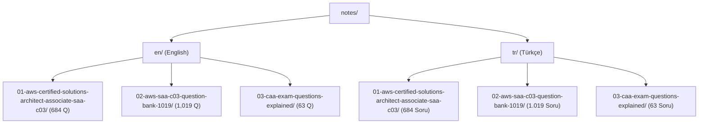

# AWS SAA-C03 Study Notes

Structured study repository for the AWS Certified Solutions Architect - Associate (SAA-C03) examination. Contains curated scenario reviews, comprehensive question banks with verified answer keys, and architectural concept callouts formatted in GitHub Flavored Markdown.

[](https://github.com/AtaCanYmc/AWS-SAA-C03-Study-Notes/actions/workflows/ci.yml)
[](LICENSE)
[](#study-modules-matrix)
[](https://atacanymc.github.io/AWS-SAA-C03-Study-Notes/)
[](https://github.com/AtaCanYmc/AWS-SAA-C03-Study-Notes/commits/main)
[](https://aws.amazon.com/certification/certified-solutions-architect-associate/)

---

## Table of Contents

- [Overview](#overview)
- [Repository Structure](#repository-structure)
- [Study Modules Matrix](#study-modules-matrix)
- [Topic & AWS Service Distribution](#topic--aws-service-distribution)
- [Interactive Quiz PWA](#interactive-quiz-pwa)
- [Exam Domains Covered](#exam-domains-covered)
- [Study Workflow & Features](#study-workflow--features)
- [Architectural Concept Callouts](#architectural-concept-callouts)
- [Technical FAQ](#technical-faq)
- [Governance and Contributing](#governance-and-contributing)
- [License](#license)

---

## Overview

This repository is a pure Markdown study resource designed for engineers preparing for the AWS Solutions Architect Associate (SAA-C03) exam. All notes are fully self-contained without runtime dependencies.

To prevent document truncation and rendering lag on mobile clients and GitHub web viewers, materials are provided in two formats:
1. **Consolidated Files (`notes.md`)**: Full-text reference files for desktop study and global regex search.
2. **Modular Sections (`sections/`)**: 25 to 100 question blocks equipped with task checkboxes for iterative study sessions.

---

## Repository Structure

The study materials are partitioned into dual-language workspaces under `notes/` (`en/` for English and `tr/` for Turkish):



### File Tree

```text
aws-saa-c03-notlari/
├── .github/
│   ├── dependabot.yml
│   └── workflows/
│       ├── ci.yml
│       └── deploy-pages.yml
├── .gitignore
├── CONTRIBUTING.md
├── LICENSE
├── README.md
├── SECURITY.md
└── notes/
    ├── README.md
    ├── en/
    │   ├── 01-aws-certified-solutions-architect-associate-saa-c03/
    │   │   ├── README.md
    │   │   ├── notes.md
    │   │   └── sections/ (section-01 to section-07)
    │   ├── 02-aws-saa-c03-question-bank-1019/
    │   │   ├── README.md
    │   │   ├── notes.md
    │   │   └── sections/ (section-01 to section-11)
    │   └── 03-caa-exam-questions-explained/
    │       ├── README.md
    │       ├── notes.md
    │       └── sections/ (section-01 to section-03)
    └── tr/
        ├── 01-aws-certified-solutions-architect-associate-saa-c03/
        │   ├── README.md
        │   ├── notes.md
        │   └── sections/ (section-01 to section-07)
        ├── 02-aws-saa-c03-question-bank-1019/
        │   ├── README.md
        │   ├── notes.md
        │   └── sections/ (section-01 to section-11)
        └── 03-caa-exam-questions-explained/
            ├── README.md
            ├── notes.md
            └── sections/ (section-01 to section-03)
```

---

## Study Modules Matrix

| Module ID | English Track (`notes/en/`) | Turkish Track (`notes/tr/`) | Questions | Focus & Exam Domain |
| :---: | :--- | :--- | :---: | :--- |
| **01** | [`notes/en/01-...`](./notes/en/01-aws-certified-solutions-architect-associate-saa-c03/) | [`notes/tr/01-...`](./notes/tr/01-aws-certified-solutions-architect-associate-saa-c03/) | 684 Items | Architectural scenario breakdowns and practice items with concept notes |
| **02** | [`notes/en/02-...`](./notes/en/02-aws-saa-c03-question-bank-1019/) | [`notes/tr/02-...`](./notes/tr/02-aws-saa-c03-question-bank-1019/) | 1,019 Items | Full question bank with verified answer keys and architectural explanations |
| **03** | [`notes/en/03-...`](./notes/en/03-caa-exam-questions-explained/) | [`notes/tr/03-...`](./notes/tr/03-caa-exam-questions-explained/) | 63 Items | Exam scenarios with detailed solution rationale and official AWS doc links |

---

## Topic & AWS Service Distribution

The 1,766 questions across the three modules cover the core AWS services as follows:

| AWS Service Category | Key Services & Topics Included | Estimated Scenarios | SAA-C03 Primary Domain |
| :--- | :--- | :---: | :--- |
| **Compute & Serverless** | EC2, Lambda, ECS, Fargate, Auto Scaling Groups, Spot Instances, Batch | ~493 items | Domain 2 (Resilient) & Domain 3 (High-Performing) |
| **Storage & Data Transfer** | S3 (Standard, Glacier, Deep Archive), EBS (gp3, io2), EFS, FSx, Storage Gateway, DataSync | ~359 items | Domain 3 (High-Performing) & Domain 4 (Cost-Optimized) |
| **Databases & In-Memory** | Aurora (Serverless/Global), RDS Multi-AZ & Read Replicas, DynamoDB & DAX, ElastiCache (Redis/Memcached) | ~274 items | Domain 2 (Resilient) & Domain 3 (High-Performing) |
| **Networking & Content Delivery** | VPC, Subnets, NAT Gateway, Transit Gateway, Route 53, CloudFront, Direct Connect, Global Accelerator | ~205 items | Domain 1 (Secure) & Domain 2 (Resilient) |
| **Security, Identity & Governance** | IAM Policies & Roles, AWS Organizations SCPs, KMS, AWS WAF, Shield, Secrets Manager, Cognito | ~179 items | Domain 1 (Secure Architectures) |
| **Application Integration & Messaging** | SQS (Standard/FIFO), SNS (Fanout), EventBridge, Step Functions, Amazon Kinesis | ~141 items | Domain 2 (Resilient Architectures) |
| **Management, Monitoring & Governance** | CloudWatch (Alarms/Logs), CloudTrail, Systems Manager, AWS Config, Cost & Usage Reports | ~141 items | Domain 1 (Secure) & Domain 4 (Cost-Optimized) |

---

## Interactive Quiz PWA

> 🌐 **Live Web Application:** [https://atacanymc.github.io/AWS-SAA-C03-Study-Notes/](https://atacanymc.github.io/AWS-SAA-C03-Study-Notes/)

For active recall practice and real-time AWS service filtering, this repository includes an offline-first **Progressive Web App (PWA)** built with Vite, React, and TypeScript located under `web/`. Automatically built and deployed to GitHub Pages on every push to `main`.

### Key Capabilities

- **1,766 Parsed Questions**: Seamlessly navigates across all three study modules.
- **Instant Service & Domain Filtering**: Filter instantly by AWS service (e.g. EC2, S3, RDS, VPC, IAM, KMS) or certification domain.
- **Interactive Practice**: Select options with keyboard shortcuts (`1-5`, `Enter`, Arrow keys), check answers instantly, review architectural explanations and official documentation links.
- **Offline & Local Progress**: Full Service Worker caching and `localStorage` persistence for bookmarks, answered questions, and accuracy rates.

### Running the App Locally

```bash
# 1. Export or update structured questions JSON
python3 scripts/export_questions.py

# 2. Launch interactive development server
cd web
npm install
npm run dev

# 3. Or build static production bundle
npm run build
```


---

## Study Workflow & Features

1. **Iterative Learning**: Open the target module folder and select a section under `sections/`. Sections take approximately 30 to 60 minutes to complete.
2. **Progress Checkboxes**: Each module `README.md` contains markdown task boxes (`- [ ]`) to track completed question batches.
3. **Offline & Mobile Ready**: The markdown files contain no external JavaScript or heavy web assets. They render cleanly in Obsidian, GitHub Mobile, VS Code, and any standard Markdown reader.

---

## Exam Domains Covered

The notes span all four official AWS SAA-C03 domains:

| Domain | Weight | Core Focus Areas |
| :--- | :---: | :--- |
| **Domain 1: Design Secure Architectures** | 30% | IAM Policies, AWS Organizations SCPs, KMS encryption, Secrets Manager, VPC security groups, Network ACLs, AWS WAF, Shield. |
| **Domain 2: Design Resilient Architectures** | 26% | Multi-AZ deployments, Aurora Global Databases, Auto Scaling Groups, ALB/NLB, SQS decoupling, SNS fanout, Route 53 failover. |
| **Domain 3: Design High-Performing Architectures** | 24% | ElastiCache Redis, DynamoDB DAX, CloudFront edge caching, S3 Transfer Acceleration, EBS gp3/io2, EFS, FSx for Lustre. |
| **Domain 4: Design Cost-Optimized Architectures** | 20% | S3 Lifecycle transitions, Glacier Deep Archive, EC2 Spot instances, Savings Plans, VPC Gateway Endpoints, Athena serverless analytics. |

---

## Architectural Concept Callouts

Every question features a structured GitHub callout block (`> [!NOTE]`) outlining:
- The verified correct option.
- The recommended solution summary.
- The fundamental AWS architectural principles governing why that specific option satisfies the scenario requirements.

### Example Callout

```markdown
> [!NOTE]
> ### 💡 Key AWS Concept & Architectural Explanation
> - **Correct Answer:** `A`
> - **Recommended Solution:** Turn on S3 Transfer Acceleration on the destination S3 bucket. Use multipart uploads to directly upload site data to the destination S3 bucket.
>
> **Exam Concept Summary:**
> - **Amazon S3 Transfer Acceleration:** Uses Amazon CloudFront globally distributed Edge Locations to route uploads over the optimized AWS private network backbone, reducing geographic transfer latency.
> - **S3 Multipart Upload:** Parallelizes large file uploads, recommended for objects > 100 MB and required for objects > 5 GB. Improves throughput and failure recovery.
```

---

## Technical FAQ

### Why are large documents split into multiple files?

GitHub restricts web rendering for Markdown documents exceeding 512 KB, and mobile clients experience lag when parsing thousands of DOM elements. The chunked files under `sections/` keep file sizes manageable while `notes.md` remains available for full-text searches.

### Can I clone and use this repository offline?

Yes. The repository consists entirely of Markdown files and image-free diagrams. You can clone it locally and browse with any Markdown editor (Obsidian, VS Code, Typora) without an active internet connection.

### How do I track my study progress?

Navigate to any module folder (such as [`notes/en/02-aws-saa-c03-question-bank-1019/`](./notes/en/02-aws-saa-c03-question-bank-1019/) or [`notes/tr/02-aws-saa-c03-question-bank-1019/`](./notes/tr/02-aws-saa-c03-question-bank-1019/)) and view its `README.md`. Mark completed sections by checking the interactive boxes.

---

## Governance and Contributing

Review [CONTRIBUTING.md](CONTRIBUTING.md) for contribution guidelines, branch standards, and pull request expectations. For security disclosure policies, refer to [SECURITY.md](SECURITY.md).

External contributions and corrections are welcome:
- To report a wrong answer key or clarify a solution, use the [Question Correction / Bug Report](https://github.com/AtaCanYmc/AWS-SAA-C03-Study-Notes/issues/new?template=question_correction.yml) template.
- To suggest features, PWA improvements, or new resources, use the [Feature Request / Suggestion](https://github.com/AtaCanYmc/AWS-SAA-C03-Study-Notes/issues/new?template=feature_request.yml) template.
- Standard checklist enforcement is automated via our [.github/PULL_REQUEST_TEMPLATE.md](.github/PULL_REQUEST_TEMPLATE.md).


---

## License

This repository is distributed under the terms of the MIT License. See [LICENSE](LICENSE) for details.
