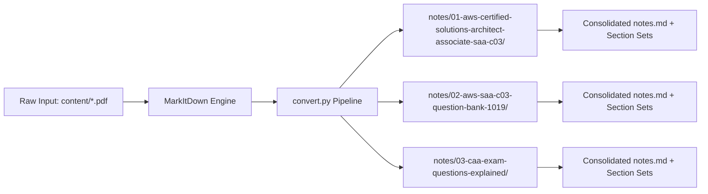

# AWS SAA-C03 Study Repository

A structured study repository and automated document conversion pipeline for the AWS Certified Solutions Architect - Associate (SAA-C03) examination. Raw source documents placed in `content/` are parsed by Microsoft MarkItDown into clean, modular Markdown files stored under `notes/`.

[](https://github.com/AtaCanYmc/aws-saa-c03-notlari/actions/workflows/ci.yml)
[](LICENSE)
[](https://www.python.org/)

---

## Table of Contents

- [Overview](#overview)
- [System Architecture](#system-architecture)
- [Directory Structure](#directory-structure)
- [Study Modules](#study-modules)
- [Quick Start](#quick-start)
- [Converter Configuration](#converter-configuration)
- [Technical FAQ](#technical-faq)
- [Governance and Contributing](#governance-and-contributing)
- [License](#license)

---

## Overview

This repository organizes preparation materials for the AWS SAA-C03 certification. To prevent rendering latency and truncated document previews on GitHub and mobile Markdown viewers, large files are divided into numbered section blocks alongside complete consolidated reference files.

---

## System Architecture

The following diagram illustrates how source documents are ingested, transformed, and indexed across the repository:



---

## Directory Structure

```text
aws-saa-c03-notlari/
├── .github/
│   ├── dependabot.yml
│   └── workflows/
│       └── ci.yml
├── .gitignore
├── CONTRIBUTING.md
├── LICENSE
├── README.md
├── SECURITY.md
├── convert.py
├── content/                                                    # Raw input PDFs (git-ignored)
└── notes/                                                      # Converted documentation
    ├── 01-aws-certified-solutions-architect-associate-saa-c03/
    │   ├── README.md
    │   ├── notes.md
    │   └── sections/
    ├── 02-aws-saa-c03-question-bank-1019/
    │   ├── README.md
    │   ├── notes.md
    │   └── sections/
    └── 03-caa-exam-questions-explained/
        ├── README.md
        ├── notes.md
        └── sections/
```

---

## Study Modules

| Module ID | Directory Path | Description | Scope |
| :--- | :--- | :--- | :--- |
| **01** | [`notes/01-aws-certified-solutions-architect-associate-saa-c03/`](./notes/01-aws-certified-solutions-architect-associate-saa-c03/) | Scenario reviews and practice questions | 684 questions |
| **02** | [`notes/02-aws-saa-c03-question-bank-1019/`](./notes/02-aws-saa-c03-question-bank-1019/) | Full practice question bank with answer keys | 1,019 questions |
| **03** | [`notes/03-caa-exam-questions-explained/`](./notes/03-caa-exam-questions-explained/) | Questions with detailed explanations and AWS documentation references | 63 questions |

---

## Quick Start

### Prerequisites

- Python 3.10 or newer
- Virtual environment (`venv`)

### 1. Set Up Environment

```bash
python3 -m venv .venv
source .venv/bin/activate
pip install -r <(echo "markitdown[all]")
```

### 2. Execute Document Conversion

Place raw source PDF files into the `content/` folder, then run the pipeline:

```bash
python convert.py
```

### 3. Direct CLI Usage

To convert any individual file directly with MarkItDown:

```bash
markitdown content/caasinav_sorular.pdf -o output.md
```

---

## Converter Configuration

The `convert.py` script maps known document patterns to configured target folders and chunking thresholds:

| Source Filename | Output Folder | Chunk Size |
| :--- | :--- | :--- |
| `AWS Certified Solutions Architect Associate SAA-C03.pdf` | `notes/01-aws-certified-solutions-architect-associate-saa-c03` | 100 questions per section |
| `AWS-SAA-C03.pdf` | `notes/02-aws-saa-c03-question-bank-1019` | 100 questions per section |
| `caasinav_sorular.pdf` | `notes/03-caa-exam-questions-explained` | 25 questions per section |

Unmatched PDF files in `content/` are automatically sanitized and converted to standalone directories under `notes/` with a default 50-item chunk size.

---

## Technical FAQ

### Why are large documents split into multiple files?

GitHub restricts web rendering for Markdown documents exceeding 512 KB, and mobile clients experience frame drops when rendering extensive DOM trees. Providing segmented files in `sections/` alongside the complete `notes.md` enables smooth browsing on all devices while preserving single-file full-text search capability.

### Are source PDF documents committed to Git?

No. The `content/` folder is explicitly excluded in `.gitignore` to avoid bloating repository size and distributing raw binary assets. Generated Markdown notes and conversion scripts remain strictly tracked.

### Does conversion require an active Internet connection?

No. The conversion pipeline operates entirely offline using local PDF parsing dependencies.

---

## Governance and Contributing

Review [CONTRIBUTING.md](CONTRIBUTING.md) for branch naming conventions, pull request expectations, and commit standards. For vulnerability disclosures and security policies, refer to [SECURITY.md](SECURITY.md).

---

## License

This project is licensed under the terms of the MIT License. See [LICENSE](LICENSE) for details.
